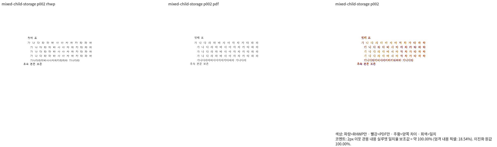
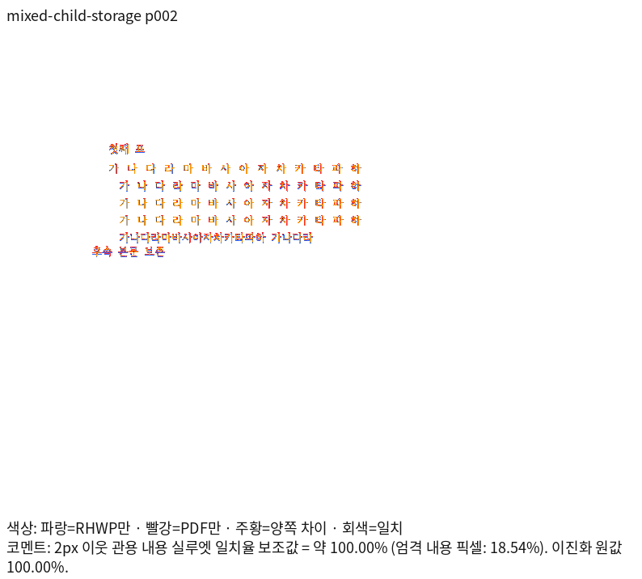
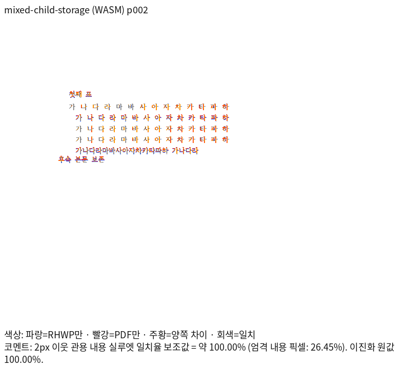

# PR #7433 검토 — 저장 줄 없는 TAC 표의 성장·줄 소속·중첩 이월

## 판정

**머지 보류 — devel 대비3문서의 전쪽 일대일 TSV 대응 미검증, 최종 전체 게이트 진행 중.**
추가 devel `cdef0073bb24512daf0622dec5051ac62cb8d57e`(#7948) 위로 리베이스를 완료했다.
현재 통합 head는 `02dfe3a748258be5206cad2c7de96da6b822be4e`이며 새 source의 영향 검증은 대기 중이다.
아래10,449건 및 시각 결과는 새 리베이스 전의 증거이며 새 head의 통과로 표시하지 않는다.
기존 저장 줄 혼재 반례의 겹침은 보정했고, 양쪽 전쪽100% 및 수정 전 FAIL/후 PASS를 확인했다.
독립 Print와 일치하는 쪽수 복구를 base TSV 누락의 자동 예외로 처리하지 않는다.
PR/push는 사용자의 별도 승인 전까지 수행하지 않는다.

- 원 PR: #7433, `imsebeom`, 원 head `d895e51ac5fd1621abb99f0a20aa52034e01e083`.
- 관련 이슈: #7419. GitHub 이슈 종료·원 PR 종료는 하지 않았다.
- 기여자 기능 `52a51c0a97d0df7baab1e815ed820c6dff7ae2bb`, 검사/입력
  `4905a31d0746fa86e23fe03655f4538079e2d0a1`을 순서대로 `-x` 체리픽했다.
  과거 보류 문서만 담은 마지막 commit은 새 검토 기록과 섞지 않았다.
- 기준: `4662c069e557e928ed7968d061121fde90b1f027`.
- 렌더링 code: `dca310c06036c7f3fa7ca30cce74c1704f1169f2`.
- 새 검사/입력 commit 및 최종 전체 검증 시작 head: `9f464aa2c`.
- branch: `review/imsebeom-7433-20261016`.
- 사용자 요청으로 fetch·원격 ref·GitHub REST head를 재확인했다. 기준은 동일해 다시 rebase하지 않았다.
- collaborator 외부 PR 체리픽 통합 경로다. 원 fork를 rewrite하지 않으며, 원 contributor head를
  직접 merge 대상으로 삼지 않는다. 통합 PR 채번용 별도 review 또는 docs-only PR을 만들지 않는다.

## 기여자 수정과 메인터너 보정

기여자는 NO_LS HWPX TAC 표의 셀 성장분을 보존했다. 메인터너는 선언 높이 합의0.5px
일치로 입력 생성 출처를 추정하던 조건을 제거했다. 중첩 표의 실제 본체 높이·바깥여백과
UTF-16 제어문 슬롯의 줄 소속을 현재 프레임이 함께 발행한다. 측정·셀 유닛·whole 배치·
partial eager/lazy paint가 같은 결과를 소비하며, 같은 줄과 여러 줄의 높이를 구분한다.

1×1 wrapper는 배치 소유자가 단일 자식 표와 폭 중립 마커일 때만 해제한다. 두 자식을
첫 표 하나로 축소하지 않는다. wrapper가 통째로 다음 쪽으로 가는 독립 Print와 대조했다.
원본 Table/Cell 참조를 유지해 주소 기반 캐시에 임시 복제 모델을 넣지 않는다.

실측 높이를 전달한 현대 NO_LS 셀만 새 프레임을 수용한다. 일반/Native 문단의 기존
보이는 글자+단일 TAC 계약은 유지한다. 새 프레임을 만들 때 저장 줄이 있는 TAC 형제도
실측 높이/소유 목록에 포함하여 셀 컷과 paint의 별도 예약·겹침을 해결했다.
자식 내부의 유효 저장 줄은 다시 나누지 않으며, 모두 저장 줄인 host는 새 경로로 넓히지 않는다.
문서 ID 분기·좌표 clamp·숨김·허용치 완화는 추가하지 않았다.

실제 생산→측정→예약/컷→배치 호출과 적용/비적용 경계는
[Stage1](../../working/task_m100_7419_stage1.md),
[Stage3](../../working/task_m100_7419_stage3.md),
[Stage4](../../working/task_m100_7419_stage4.md)에 연결한다.

## 독립 출력과 직접 판독

- 원본2개 및 선언 높이·작은 용지·동일 줄·명시적 개행·폭 부족·문맥·여백·분할·wrapper
  반례9개는 수동 XML이다. 실제 한컴 저장 출처로 주장하지 않는다.
- 새2개는 실제 한컴 HWP→HWPX 저장본의 LineSeg 일부만 제거한 혼재 입력과 대조군이다.
  생성 job·남긴 저장 줄·SHA는 [입력 기록](../../../tests/fixtures/issue7419-boundaries/README.md)에 있다.
- 독립 기준은 같은 입력의 한컴2024 13.0.0.3901 PrintMethod0,
  `frame_print_to_pdf_ex_one_up` PDF다.
- dca source의 **13문서19쪽 Native/fresh WASM 양쪽 최저100%, 미달·누락0, Print 쪽수 일치**.
  2px 관용 실루엣이며 엄격 픽셀100%가 아니다.
- 양쪽과 독립 Print의 같은19쪽 영역을 직접 대조했다. 줄바꿈·표 외곽/점유·자식 쪽 소속·
  뒤 본문·여백·누락·중복을 확인했고 겹침이나 추가 빈 쪽은 관측하지 않았다.
  이 입력에 없는 수식·각주 조합은 새로 검증했다고 주장하지 않는다.
- Native는 `native-skia` PNG, fresh WASM도 PNG 경로다. 같은96dpi·Print profile·compat2024·
  한컴 글꼴을 사용하고 source SHA와 실제 생산자 해시를 기록했다.
- Docker 미설치 호스트여서 locked wrapper의 host `--dev --no-opt` 진단 경로를 사용했다.
  Docker 표준 빌드나 GitHub CI 성공으로 표시하지 않는다.

## 정식 회귀와 수정 전후

[정식 검사](../../../tests/cases/issue_7419_no_ls_tac_row_growth.rs)는14개다.
원본2개의 고정 영역 선택을 셀 내용·순서·포함·비겹침 관계로 교체했다. 관계 검사13개가
같은 줄/개행/폭 부족/문맥/여백/이월/조각 종료/저장 줄 혼재를 보호한다.
완료 페이지18쪽의 핵심 제목·후속 본문 원점은 독립 PDF span.origin을96dpi로 환산한
±2px 검사1개로 함께 보호한다. 작은 용지1쪽은 제목만 있어 추가 위치 핀을 만들지 않았다.

| source/생산자 | 검사와 실제 결과 |
| --- | --- |
| 초기10개 | devel0pass/10fail, 원 체리픽3pass/7fail, 최초 보정10pass |
| 분할2개를 추가한12개 | 여백 앵커 오류10pass/2fail → 보정12pass |
| 59d의 기존 실패3개+당시12개 | 실제 Cargo15pass. 시행령74쪽 render tree가 devel과 바이트 동일 |
| dca의 현재14개 | 준비한 suite에서 실제 Cargo14pass/실패0 |
| 같은14개 실행 파일, 출력 CLI59d→dca | 12pass/2fail →14pass/0fail. 혼재 자식의 쪽 소유와 독립 좌표가 의도한 원인으로 실패 |

전부NO_LS인 새 대조군은59d/dca 모두 통과한다. 실제 저장 host 정상 대조군2쪽 render tree도
두 source에서 바이트 동일하다. 이 비교만으로 해당 정상 대조군의 독립 Print 정확도를 주장하지 않는다.
초기 stale generated suite 실행0건/exit4는 통과로 세지 않았다. `--prepare` 후 runner로14건을
실제 실행했다. generated harness/manifest는 커밋하지 않는다.

## 최종 전체 게이트

- 첫 source `fafd0d378` 전체는10,447건 중10,444pass/3fail/45skip이었다. 일반/Native까지
  수용을 넓힌 원인을 고쳤으며 기존 기대값·baseline·허용치를 바꾸지 않았다.
- 59d의 lint6종과 집중15개 통과는 과거 source 증거다. 새 혼재 실패를 확인해59d 전체 빌드는
  테스트 시작 전에 SIGINT로 중단했다(pipeline exit130, test summary 없음).
- **9f464aa2c의 release-test 전체10,449pass/실패0/45skip을 확인했다**(실행713.108초, 빌드11분18초).
  이전 실패3개와 이번14개도 모두 통과했다. 이어서 lint6종 → Native Skia3종을 공용 target에서 순차 실행 중이다.
  집중14개와 이전 source 결과를 합산해 현재 전체 통과로 표시하지 않는다.
- `CARGO_BUILD_JOBS=8`, `/home/tsjang/rhwp/target/pr-review`를 사용한다. 다른 Cargo를 동시에 실행하지 않는다.
- Studio 원본2개의 Canvas2D/CanvasKit compat/default software6캡처는59d 당시의 추가 증거다.
  초기 WASM 응답 해시6개 일치, replay hard violation0. 엄격 픽셀4건은 report-only 불일치
  (최대0.01088193)였다. 이를 dca의 Studio 재실행 또는 parity gate 성공으로 승격하지 않는다.

## devel 전쪽 대응 gate

같은 입력·독립 Print·글꼴·DPI·profile로 비교 가능한10문서의 backend별12쪽에서
0.01%p 이상 하락0, 조건 불일치0이다. 새 혼재2문서는 base도2쪽이라 페이지별 비교가 가능하다.
아래3문서는 정상 쪽수 복구로 base 전체 TSV가 없어 전쪽 일대일 대응이 아직 미검증이다.

| 입력 | base Native/WASM | 현재 후보/독립 Print |
| --- | --- | --- |
| page-height-28000 | 2/2쪽 | 3/3쪽 |
| partial-nested-width-wrap | 1/1쪽 | 2/2쪽 |
| partial-nested-wrapper | 1/1쪽 | 2/2쪽 |

사용자의 현행 기준 유지 지시에 따라 `re_review_required`를 유지한다. 이 문서를 검증에서
제외하거나 Print/쪽수 기대값을 바꿔 보류를 숨기지 않는다. 전체 테스트가 통과해도 이 보류와
사용자 PR 승인 조건을 별도로 충족해야 한다.

## 현재 시각 자산

[자산·SHA 목록](../assets/pr_7433_maintainer/README.md). 사용자 판독을 위해 review와 overlay를 함께 표시한다.

## 원시 증거와 원격 상태

현재 증거는 ignored `output/pr-review/pr7433-current-20261016/mixed-storage-fix/`에 있다.
`native-build.json`, `wasm-build.json`, `focused.json`, `before-after.json`,
`mixed-visual-evidence.json`, `final-direct-read.json`, `final-devel-comparison.json`,
`all-saved-comparison.json`, `review-assets.json`, `full-summary.json`, `final-pipeline.log`,
`{full,lint,native}-validation.json`을 사용한다. 파일 존재 자체를 완료 근거로 쓰지 않는다.
이전 source 증거는 `regression-fix/`에서 보존한다. TSV·로그·중간 JSON은 커밋하지 않는다.
주 작업공간 Studio JS의 사용자 dirty 변경은 보존했다.
PR 생성·push·CI·merge·원 PR 종료·post_merge 정리는 아직 수행하지 않았다.
