# PR #7600 리뷰 — dyad 붙여쓰기와 양쪽 화살표

## 최종 판정

**머지 보류 — 전체 회귀의 px 고정 검사와 시각 대조군 보정 진행 중.** #7593 공개 원본의
최신 Native/fresh WASM 전체1쪽은92.98588%, 최소 입력은99.43478%다. 필수 fmt·세 Clippy·workspace
build·base 정책과 원 기여3검사는 통과했다. 첫 전체 nextest는10,517 실행 중10,514PASS/3FAIL/50SKIP
(exit100,730.063초)로 종료했다. 문28의 고정 영역 검사는 `(ii)` 자체의 인라인 수식을 앞 수식으로
잘못 선택했고, #1308의 두 SVG 검사는 강제 줄바꿈 수식을 고정 y 범위로 찾지 못했다.

사용자가 #1139 파일 전체의 px 고정 검사를 문단 소유·위치 순서 관계로 바꾸도록 범위를 확장했다.
해당 입력의 Native/fresh WASM90% 선행 조건과 독립 Print 출력부터 확인하며 기존 검사는
자동 삭제하거나 임계값을 완화하지 않는다. 최종 Skia/전체 재검증·PR 생성은 아직 수행 전이다.

원격 통합 PR의 push/생성·최신 head CI·merge 및 원 PR 후속 처리는 수행하지 않았다.
원 head의 녹색 CI를 새 메인터너 후보의 CI로 대신하지 않는다. #7594의 별도 기호 모양/의미
문제, macOS/Windows 시스템 글꼴 실행은 검증 범위 밖이다.

## 접수와 검토 head

| 항목 | 값 |
| --- | --- |
| 원 PR·작성자 | [#7600](https://github.com/edwardkim/rhwp/pull/7600) / Phantomn / 첫 기여자 |
| 관련 이슈 | [#7593](https://github.com/edwardkim/rhwp/issues/7593) 해결 범위; [#7594](https://github.com/edwardkim/rhwp/issues/7594) 별도 문제 유지 |
| 원 head·fork | `dbb87b98047ffb73ff038374a59501495a47bdf2` / Phantomn/rhwp / fix/issue-7593 |
| 검토 base | `a048da32d2b76867283aa6dbdf2578816a0e6238` / upstream/devel |
| 검토 branch·체리픽 | `review/phantomn-pr7600-20261006` / `5d7a2ad98` (원 저자 보존, 충돌 없음) |
| 메인터너 런타임 source | `1a7ad89e4` → `557a1c91c` → `9ee2878be489e5dc4a6efc4c751a65465e32c571` |
| 배포·회귀 후보 | `84fda69394ca359cc121705da270636dc2d67670` (배포 계약), `31c1d4ecd6cfd0fce50658fccce158cf876b8077` (추가 회귀); Rust 런타임은9ee2878be와 동일 |
| reviewer·라우팅 | jangster77 / collaborator_external_pr + first_time_contributor + intake_and_review + local_validation + visual_fixture_evidence |
| 원 PR 상태 재확인 | 2026-10-06 Open, non-draft, MERGEABLE/CLEAN, head unchanged, maintainer_can_modify true |

원 기능·메인터너 보정은 별도 일반 commit으로 누적했다. contributor history를 rewrite하지 않았다.
원시 TSV3개는 `08abab871`에서 Git 제외하고 ignored output에 보존했다. 단일 원 PR의 검토/보정
문서와 오늘할일을 같은 통합 후보에 유지하며 통합 PR 번호를 예측한 별도 문서는 만들지 않는다.

## 초기 보류 사유와 실제 보정

| 초기 사유 | 독립 실행·조치 | 현재 상태 |
| --- | --- | --- |
| 과거79.8%/64.3% 실패 입력 미제공 | 사용자 확인: 다른 문서는 없음. 공개 이슈 입력을 원 바이트로 확보하고 실제 Print에서79.58463%/바탕쪽 선 누락 재현 | 공개 원본은 보정·재검증 완료; 미제공 과거 파일과 같은 입력이라고 추정하지 않음 |
| 기존 PDF의 Print 출처 미확인 | Creator만으로 출력 방법을 판단하지 않음. 스크립트 없는 사본을 MCP Print로 출력하고 기존 PDF와 전쪽 raster 동일성 확인 | 새 PDF의 실행 Print 계약과 원문 대응으로 해소; 기존 출력 메뉴는 별도 미확인 |
| 바탕쪽 선·보기 기준선·선택지 위치 | 저장 master frame을 paint하고 flow를 밀지 않음; 저장 수식 flow baseline을 실제 배치도 소비; 저장 줄이 없으면 TabDef에서 재조판 | 원본 전체1쪽 판독·관계 회귀로 확인 |
| 실제 SVG의 잘못된 font fallback | fc-match만으로 공급을 확인했다는 초기 기록 정정. SVG 내장 name table의 실제 face 검증 후 시스템 family/weight 조회 보정 | Han Santteut Dotum Regular/Bold·HCR Batang 공급 확인; 별도 RHWP_FONT_PATH 미사용 |
| 실제 CanvasKit의①/② 내용 누락 | 없는 U+2AFD 때문에 전체 수식 paint가 실패. 같은 codepoint의 정식 Noto Sans Math glyph fallback 공급 | 새 WASM/실제 Canvas2D·CanvasKit4경로 표시 통과; hidden overlay 없음 |
| 발문 AB의 약2배 장평·관계 기호 간격 | 흐름 예약 bbox와 BaseUnit의 실제 paint 폭 분리; rm 정체 상태 보존; 관계 glyph/양쪽 공간을 공통 Row 결과로 소비 | 최신 전쪽·확대 판독 완료; 추가 회귀 RED3FAIL/선행 GREEN6PASS |

구현 근거·반례·전후 실행은 [보정 기록](pr_7600_review_impl.md)에 연결했다.
기존 golden/baseline 허용치·90% 기준을 완화하지 않았고 글꼴 예외를 사용하지 않았다.

## 구현 주장과 조판 원칙

| 주장 | 생산 → 소비 경로와 실제 검사 | 판정 |
| --- | --- | --- |
| dyad 붙여쓰기와 양쪽 화살표 | read_command/longest_keyword_prefix → EqLayout Decoration → SVG/Canvas2D/Skia/CanvasKit; 원 기여3검사·벡터 대조·표시 E2E | 충족(검증한 Native/WASM/브라우저 범위) |
| 측정/배치 기준선 공유 | flow_metrics_hwp → composer 줄 측정 → inline_baseline_px → paragraph_layout의 두 EquationNode 원점 → painter; 같은 저장 기준선 비율·TextRun CellContext 소유와 최종 순서 검사 | 충족(본문/셀 원본 및 최소 입력) |
| 저장 줄 없는 탭 재조판 | 기존 para_has_no_stored_line_segs → ComposedParagraph.tab_extended → TabDef 기반 커서; 원 metadata 보존, 저장 줄 경로의 advance 유지 | 원본 관계 검사 충족; 정상 대조군은 전체 회귀 결과로 확인 |
| 바탕쪽 선의 소유/비흐름 | master ColumnDef 저장 frame → 공통 separator → 실제 MasterPageLine; 저장 frame 비율·ColumnDef 소유·다음 본문 보존 검사 | 충족(원본/최소 대조) |
| 동일 BaseUnit의 자연 paint 폭 | EqLayout intrinsic → 네 painter, bbox 예약은 흐름에만 소비; 실제 Print SVG의 조상 transform 포함 장식 폭 비교 | 충족(동일 AB 세 문맥); 일반성은 전체 회귀 결과로 확인 |
| 관계 기호 양쪽 간격 | tokenizer/parser 공통 분류 → MathSymbol의 glyph/Space Row → 모든 painter; BOT/직접Unicode의 내용·순서·점유 영역 비겹침 | 충족(실제 원본 두 관계 입력); Greek 합성은 진단만 수행 |
| 저장 정보의 독립성 | 실제 한컴 저장 입력·MCP Print를 기준으로 검증; 문서 ID/우연한 속성/좌표 clamp를 추가하지 않음 | 충족 |
| 분할/이어받기·rowspan/clipping | 이번 변경은 분할 컷·소유 유닛·예약 높이·종료 조건을 바꾸지 않음 | 해당 구현 원칙 비해당; 전체 회귀 무회귀는 별도 게이트 |
| 시스템 글꼴 모듈 | Native fontdb의 공통 시스템 family/weight 조회; Linux 실제 실행. WASM cfg 제외, TTC index0 이외 기존 제한 유지 | Linux 충족; macOS/Windows 실행 미검증 |

## 입력·독립 Print PDF의 보존

| 파일 | SHA-256 | 출처·역할 |
| --- | --- | --- |
| `samples/issue7593/repro-equation-issue7593.hwpx` | `88a3683c34e92f8887e54b9b379f8c399a8ec844e46e127793c6486cba8d31ec` | 공개 이슈 원본, Phantomn/rhwp의 issue-assets8e49f1b8e 원 바이트 |
| `samples/issue7593/repro-dyad-min-no-script.hwpx` | `7f12969bce23d268cd2cc1d1ebd20f64582755373afd91035e2278ecf0aa7e69` | 원 PR 최소 입력의 기본 빈 Scripts만 제거; 모든11개 조판/content entry byte 동일 |
| `pdf/issue7593/repro-equation-issue7593-hwpx-2020.pdf` | `206b9fc127a8f40e63fc49ba86ebd455f7d4e651e1f32dbf68d3915052d9f8db` | 공개 원본의 MCP2020 Print, job c0af74c9-1bcf-454d-b177-08ab91b24e59 |
| `pdf/issue7593/repro-dyad-min-no-script-hwpx-2020.pdf` | `ba0df59511f46087b7b08bd93fa02e2fe216207a355ebc1fefe8f5413bf3b7cb` | 사본의 MCP2020 Print, job261546f2-3bbd-4f1a-b550-6d42e5945d5b |

네 파일은1a7ad89e4에 포함했고 실행 바이트와 commit 일치를 확인했다. 원 최소 입력
`mydocs/pr/assets/issue_7593_dyad_arrow/repro-dyad-min.hwpx` (SHAc8605b6d…) 및 기존 PDF도 보존했다.
원본의 macro는 실행하지 않았다. 원본 MCP 거부 `HANCOM_MACRO_MANUAL_PROCESSING_REQUIRED`와
스크립트 사본의 변경 entry/동일 출력 증거는 output에 보존했다.

두 새 기준은 Hancom11.0.0.9136 / pdf_print_method0 / hancom2020_pdf_driver_one_up의
실제 성공·다운로드를 확인했다. PDF1.4 / Creator Hwp2020 0.0.0.0 / Producer HancomPDF1.3.0.550,
각 전체1쪽이다. 문서 저장 제품과 canonical selector로 engine2020 짝을 확인했다.
2024MCP usage의 Print 계약/bridge를 따랐으며 금지된 직접 변환 스크립트나 LibreOffice는 쓰지 않았다.
기준 연도/Creator 문자열만으로 PDF를 거부하지 않았다.

## 전체 페이지 시각 결과와 명령

검증 source9ee2878be, 실행 head84fda6939. Native와 새 최적화 WASM의 실제 출력으로
두 문서 모두 **전체1쪽**을 비교했다. 평균으로 미달 쪽을 감추지 않았다.

| 입력·쪽 범위 | Native 최저 | fresh WASM 최저 | 90% 미만 / 누락 / 측정 불가 | gate |
| --- | --- | --- | --- | --- |
| 공개 원본 p1 / 전체1쪽 |92.98588%|92.98588%|0 / 0 / 0|passed|
| 최소 입력 p1 / 전체1쪽 |99.43478%|99.43478%|0 / 0 / 0|passed|
| 원 최소 입력 ↔ Scripts 제거 사본 |100%/픽셀 동일|별도 비교 미실행|0 / 0 / 0 (Native)|최신 Native pair 직접 확인|
| 원 최소 입력 ↔ 기존 기여자 PDF |99.43478%|99.43478% (같은 최신 WASM raster 직접 TSV 비교)|0 / 0 / 0|Native 정식 gate passed; WASM TSV-only는 not_evaluated|
| 기존 PDF2022 ↔ 새 Print PDF2020 |100%/픽셀 동일|출력 backend 비해당|0 / 0 / 0|고정 PDF 두 파일의 전쪽 raster 직접 확인|

최적화 build: 저장소 루트에서
`CARGO_TARGET_DIR=target/pr-review scripts/wasm-pack-locked.sh --target web --out-dir pkg` exit0.
pkg/public/실제 Studio download WASM SHA-256은
`cf850c529720d37cef7953f6ef03d857662110d408e55a2decb9bd5029a43c18`;
JS는 `70cde06a369fa7fd4fc8bc8f3d6acaee158596ba1a116a2c72159002b0b5654e`다.
추적된 public/rhwp.js는 새 build 뒤 byte 동일하므로 추가 diff가 없다.

```bash
python3 scripts/visual_sweep.py \
  --hwp samples/issue7593/repro-equation-issue7593.hwpx \
  --pdf pdf/issue7593/repro-equation-issue7593-hwpx-2020.pdf \
  --key issue-original --rhwp-bin target/pr-review/release-test/rhwp \
  --pages 1 --dpi 96 --embed-fonts=full \
  --out output/pr-review/pr7600/spaced-native-issue
# fresh WASM은 --wasm-pkg pkg 및 --out .../spaced-wasm-issue 추가/변경.
# 최소 입력은 위 표의 사본/대응 PDF, --key min-print, .../spaced-*-min 사용.
python3 scripts/visual_sweep.py --silhouette-only \
  --png-pair output/pr-review/pr7600/spaced-native-issue/issue-original/rhwp_png \
  output/pr-review/pr7600/spaced-native-issue/issue-original/pdf_png \
  --out output/pr-review/pr7600/spaced-native-issue-scores
```

4개 정식 Sweep run_manifest의 gate와 전쪽 TSV/직접 판독을 함께 확인했다.
TSV-only의 not_evaluated 자체는 승인 판정으로 쓰지 않았다. 별도 font-path/예외는 없다.
`output/pr-review/pr7600/spaced-{native,wasm}-{issue,min}-scores/silhouette.tsv`가 원시 결과다.
**Native TSV 원본3개 ZIP** `output/pr-review/pr7600/pr7600-native-all-pages-tsv.zip`을 준비했다.
로그·원시 TSV·JSON·ZIP·nextrun은 output에 보존하며 Git에 커밋하지 않는다.

### 공개 원본 — p1 전체 페이지

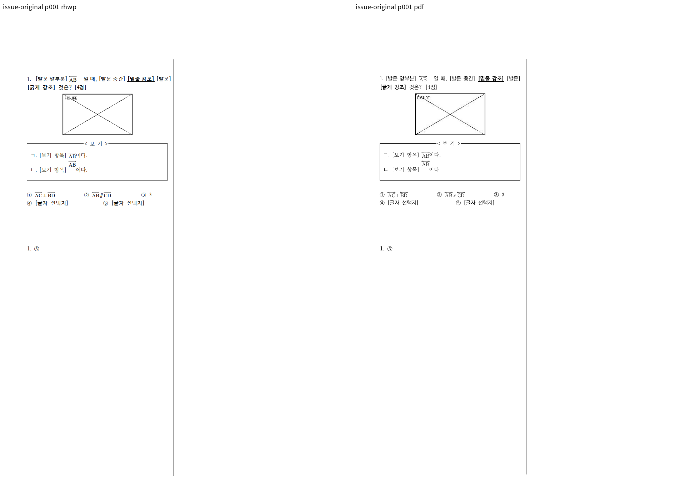

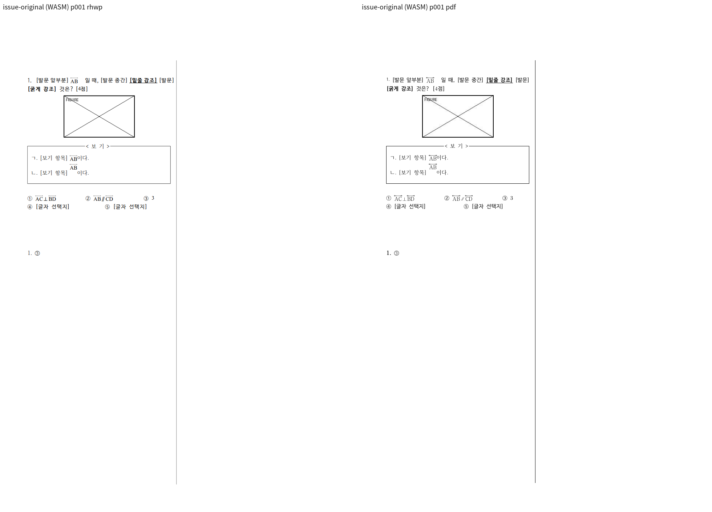

| 경로 | review | standalone overlay |
| --- | --- | --- |
| Native | 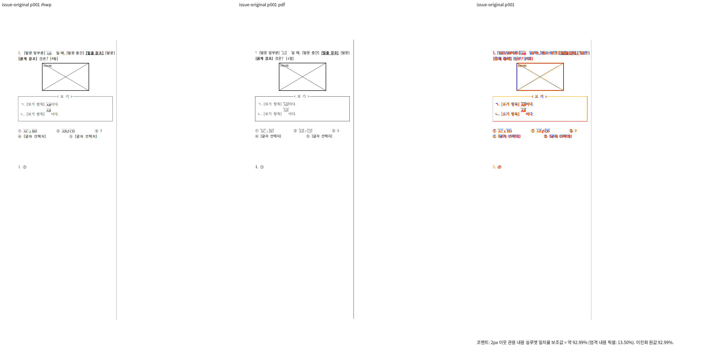 | 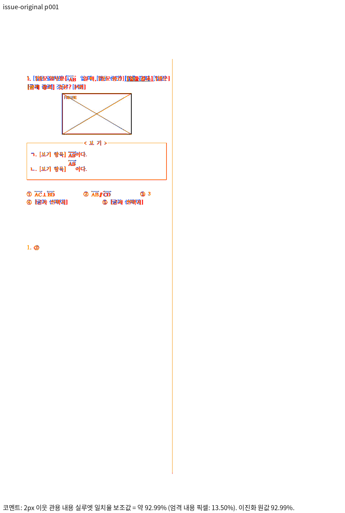 |
| fresh WASM |  | 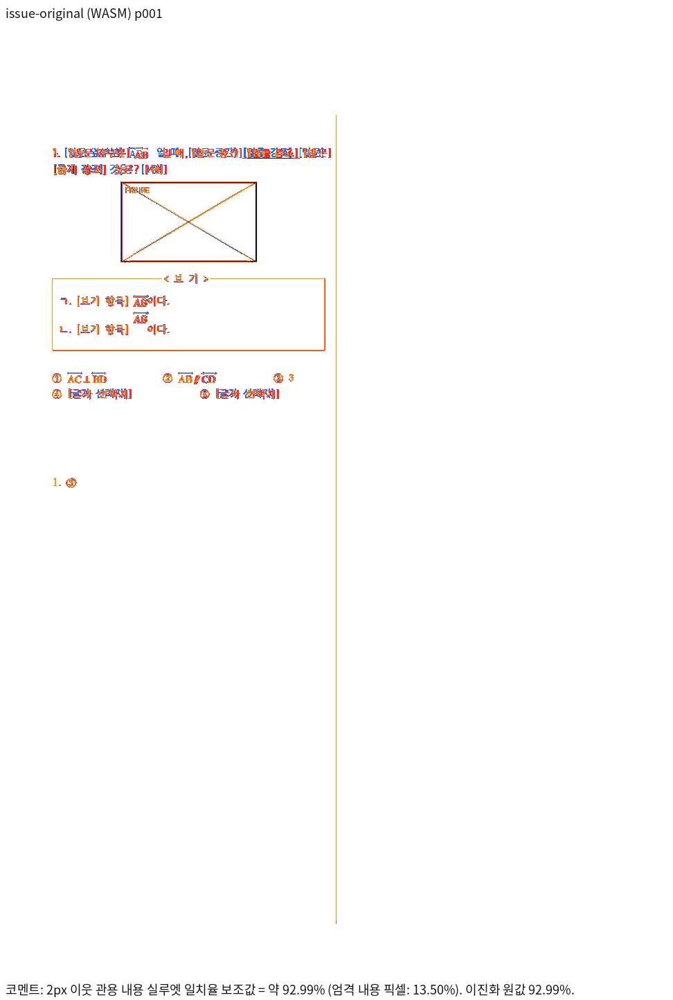 |

바탕쪽 구분선·그림·보기 외곽, 보기 ㄴ의 수식 높이/소유, AB의 자연 장평, 관계 기호 양쪽 간격,
다섯 선택지와 뒤 정답의 위치·순서·누락을 직접 확인했다.

### 최소 입력 — p1 전체 페이지

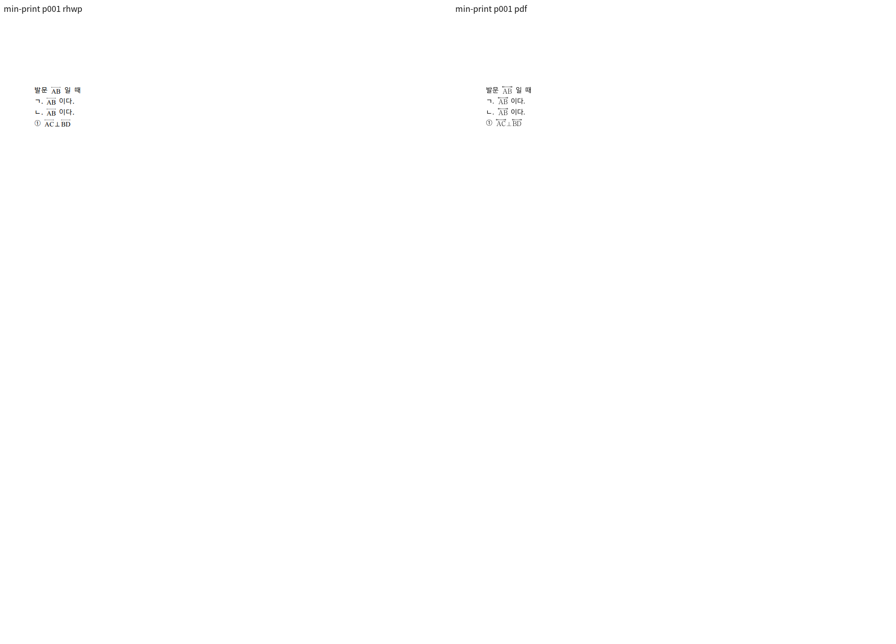

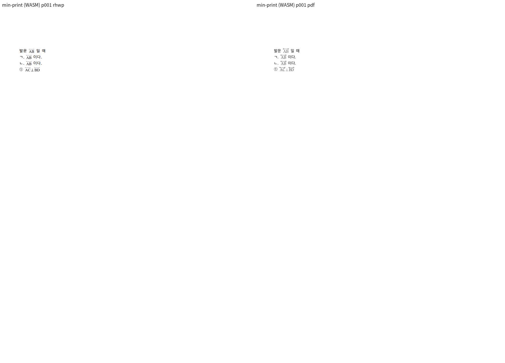

| 경로 | review | standalone overlay |
| --- | --- | --- |
| Native | 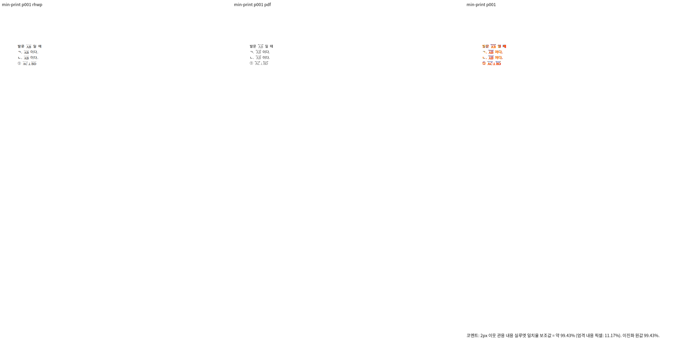 | 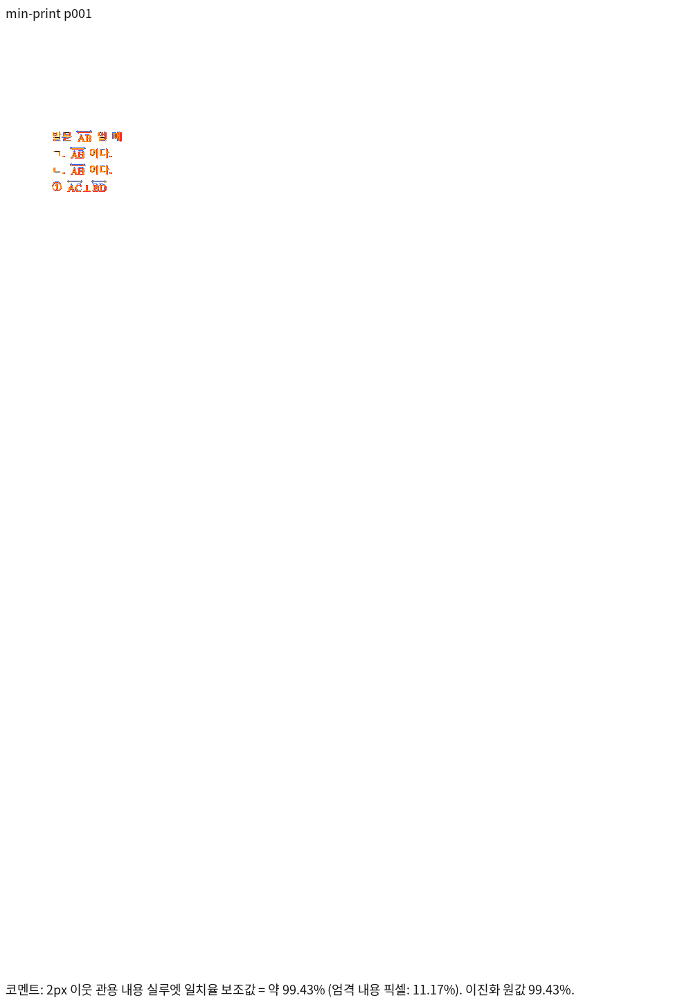 |
| fresh WASM | 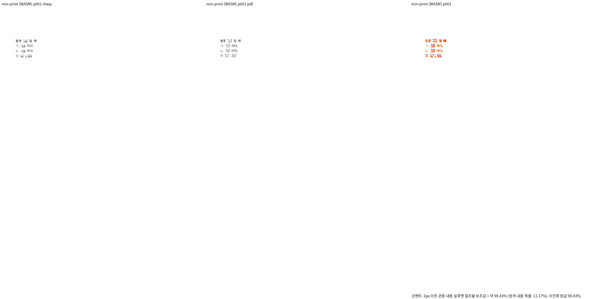 | 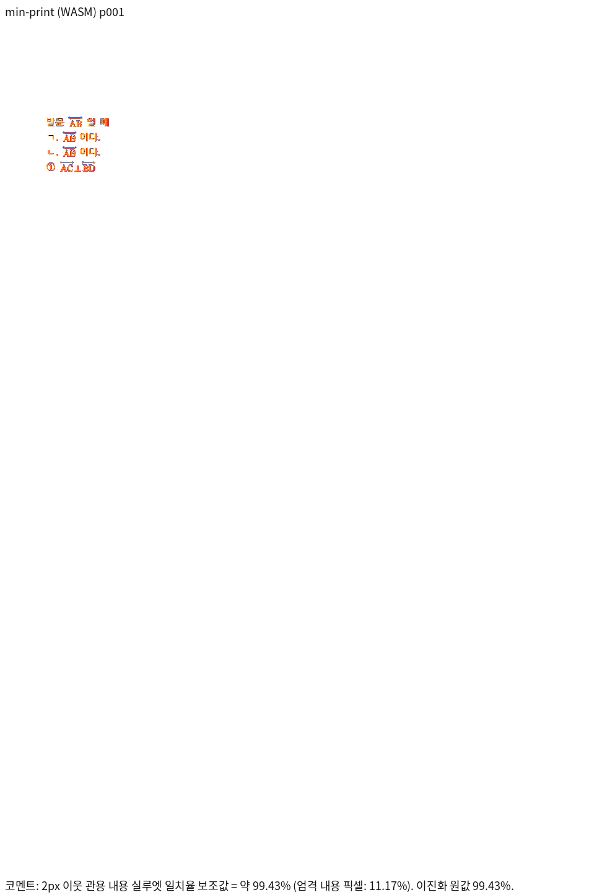 |

4행·4수식·5개의 양쪽 화살표, 관계 기호 앞뒤 내용/간격 보존을 확인했다.
사용자가 지정한 원 PDF도 원 최소 HWPX/최신 Native로 직접 재비교해99.43478%/gate passed를
확인했다. fresh WASM raster를 이 PDF의 같은 PNG와 직접 비교한 TSV도99.43478%다.
두 독립 기준 PDF 사이100%와 RHWP 대 PDF99.43478%를 구분한다.

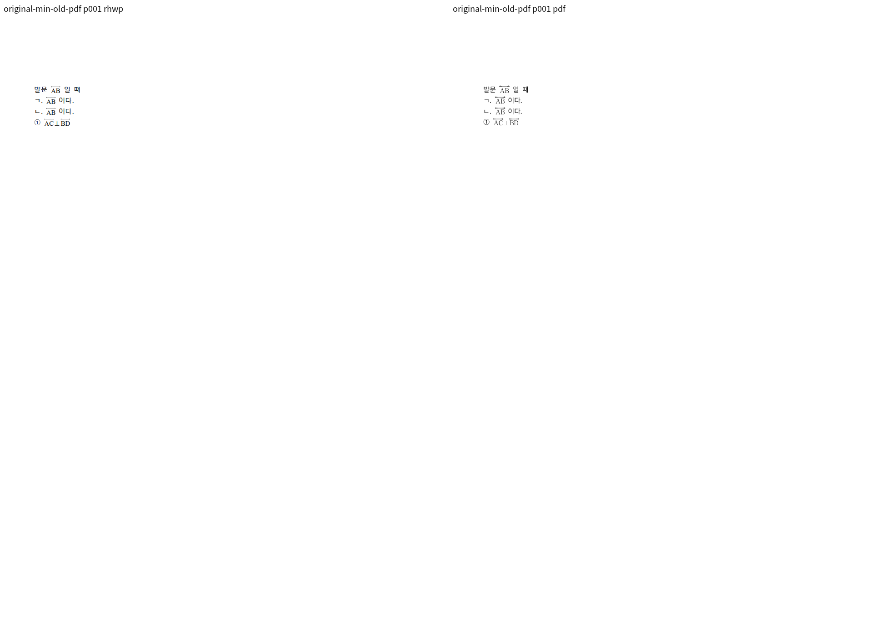

[발문 수식 전후/Print 확대](../assets/pr_7600_review_20261006/equation-first-line-before-after-print.png),
[선택지 간격 전후/Print 확대](../assets/pr_7600_review_20261006/choices-before-after-print.png)도 보존했다.
글꼴별 획·작은 원점 차이는 남는다. 자동 보조값을 완전 glyph 일치나 #7594 해결로 확대하지 않는다.

## 로컬 검증과 실제 표시

- 관계 기반 기존3검사: 수정 전a0db9c052의3FAIL → 보정 후3PASS. 선0개/기준선 순서/탭 격자 비율로 검출했다.
- 신규 paint/관계3검사:7a61272f1의3FAIL(기존3PASS), 보정 후 재실행6PASS(exit0). 장식 폭39.99996 대20.02, BOT 간격, 직접Unicode의 MathSymbol0개로 검출했다. 최종 전체 결과는 진행 중이다.
- 원 기여 glued dyad/화살표 focused3PASS. 정식 suite를 prepare한 뒤 실제 test count로 확인했고 빌드 오류·0tests를 red/pass로 세지 않았다.
- Studio TypeScript PASS, npm1,815PASS/0FAIL/2SKIP, 실제 CanvasKit font coverage PASS, E2E MANIFEST150파일/150행 PASS.
- 최신 브라우저 E2E는 Canvas2D/CanvasKit × 두 문서4PASS. 실제 수식 내용, backend, fresh WASM download 해시 및 CanvasKit hidden overlay 없음/지원 오류0을 확인했다. `logs/browser-final.log` 및 browser-final/results.json.
- [실제 Studio 공개 원본](../assets/pr_7600_review_20261006/studio-canvaskit-issue.png), [실제 Studio 최소 입력](../assets/pr_7600_review_20261006/studio-canvaskit-min.png)의 CanvasKit 화면을 직접 확인했다. render tree의 Equation 개수만으로 표시를 판정하지 않는다.
- Studio/Chrome/Firefox/VS Code 최종 배포 build 및 font/extension 계약9PASS. dist WASM은 새cf850c52와 동일하다.
- Noto Sans Math2.001 전체 TTF→WOFF2(226,456bytes), 동일2,655glyph/2,472codepoint이며 subset/문자 치환 없음. 원 font의 Copyright2018 Google LLC 및 SIL OFL1.1을 `NotoSansMath-OFL.txt`, `FONTS.md`, `THIRD_PARTY_LICENSES.md`에 보존했다. 모든 배포본에서 라이선스 전문 byte 일치를 확인했다.
- oracle 쪽수 원장에 독립 Print로 확인한 두1/1행만 등록했다. 다른 golden/baseline/래칫 허용치는 변경하지 않았다.
- 필수 fmt·세 Clippy·workspace build·base 정책 PASS. 첫 전체 nextest는10,514PASS/3FAIL/50SKIP. #1139/#1308 보정 후 전체 재검증과 Native Skia3종은 남아 있다.
- 원 head의 [Full CI](https://github.com/edwardkim/rhwp/actions/runs/37317981931), [Render Diff](https://github.com/edwardkim/rhwp/actions/runs/37317981119)는 원 head의 증거다. 새 integration 후보의 원격 CI는 아직 없다.

## 통합 및 merge 후속 처리 계획

로컬 준비가 완료되면 한국어 PR 본문 초안·실제 head SHA 고정 raw Markdown 이미지·Native TSV ZIP을
준비한다. 사용자 remote push/PR 생성 승인 후 upstream의 임시 head에서 devel 대상 통합 PR을
등록한다. 최신 code candidate CI가 녹색인 뒤 남은 review·오늘할일을 같은 PR의 trailing 기록으로
확정하고 최종 head CI/mergeability를 다시 확인한다. 원 contributor branch에는 직접 push하지 않는다.

통합 후 정확한 merge SHA·검증 CI URL·같은 asset의 merge SHA raw URL·남은 차이와 첫 기여 안내를
한국어 존댓말 contributor comment로 게시하고 API 재조회한다. 원 PR은 통합 PR을 연결해 대체 close하고
#7594는 열어 둔다. upstream/devel 포함·동기화·소유한 임시 branch만 정리하며 shared target/다른 작업은 보존한다.
