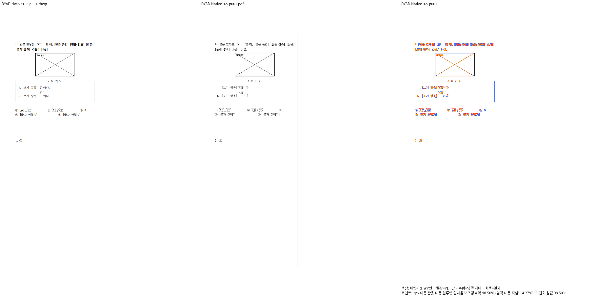
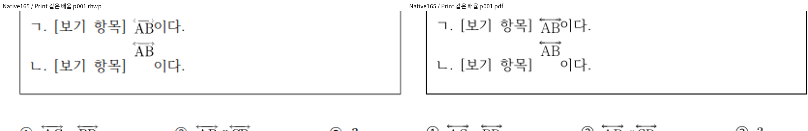

# DYAD 저장 예약 프레임 보정의 시각 증거

## 원본과 독립 기준

- 구현 SHA: `c7472832df262ec48c639f35b29301ad9365c4a8`.
- 입력: `samples/issue7593/repro-equation-issue7593.hwpx`.
  SHA-256: `88a3683c34e92f8887e54b9b379f8c399a8ec844e46e127793c6486cba8d31ec`.
- 기준: `pdf/issue7593/repro-equation-issue7593-hwpx-2020.pdf`.
  SHA-256: `206b9fc127a8f40e63fc49ba86ebd455f7d4e651e1f32dbf68d3915052d9f8db`.
  원본에 대응하는 독립 한컴 2020 Print PDF를 재사용했다.
- Native 바이너리 SHA-256:
  `4bff05b4a36ea5600363e7c9272448a11c3b41090a8cc23917f1921ffb3c24a0`.

## Native 결과와 확대 판독

전체 1쪽의 2px 이웃 관용 내용 실루엣 일치율은 **98.50470%**다.
직전 구현의 91.61325%와 같은 원본·기준·배율로 비교했다.
최소 대조군 `repro-dyad-min-no-script.hwpx`는 전체 1쪽 **99.17678%**다.
실행은 `--compat 2022 --embed-fonts=full --dpi 96 --silhouette-only`를 사용했다.

보기 ㄴ의 큰 저장 예약 높이를 보존해 수식은 위쪽, 뒤 본문은 낮은 기준선에
표시된다. 보기 ㄱ/ㄴ의 AB 순서·정체와 양방향 장식, 앞뒤 본문 간격과 표 테두리를
같은 배율로 확인했다. 글꼴의 가장자리 농도·윤곽에 작은 차이는 남는다.
전체 페이지 점수만으로 세부 판독을 대신하지 않는다.

## 증거 위치와 남은 검증

원본 TSV·로그·해시 영수증은 ignored
`output/pr-review/issue7642/failed-inputs-20261008/stage15-current-validation/`의
`stage165-dyad-native/receipt.json`과 각 대상의 `silhouette.tsv`에 있다.
PNG는 해당 새 Native 출력에서 만들었다. 이전 head PNG를 재사용하지 않았다.

fresh WASM은 현재 새 빌드가 진행 중이며 이 기록의 Native 결과로 대신하지 않는다.
관계형 검사, 전체 대상의 최종 head 재검증·회귀·lint와 PR 제출 게이트는 아직 남아 있다.
