# Print bitmap 전달·표본과 정상 그림의 회귀 증거

## 같은 원본의 전쪽 선행 검증

출력 엔진 source는 `d7d4d2ea6ed427f2f3bc8b59a936a5f99aca852b`다. Native/fresh WASM은 같은 원본·독립 Print·96 DPI를 사용했다. 판정값은 색상 경계 보정 전2px `silhouette_raw_match_percent`이며 정확히90%도 통과한다.

| 문서 | 쪽수 | Native 최저 | fresh WASM 최저 | 전체 TSV |
| --- | ---: | ---: | ---: | --- |
| prep | 140 | 93.97471% | 93.70762% | [Native](prep-native-silhouette.tsv) / [WASM](prep-wasm-silhouette.tsv) |
| palette | 1 | 99.98227% | 99.98255% | [Native](palette-native-silhouette.tsv) / [WASM](palette-wasm-silhouette.tsv) |
| legal | 74 | 94.95118% | 94.80658% | [Native](legal-native-silhouette.tsv) / [WASM](legal-wasm-silhouette.tsv) |

## 입력·독립 한컴 Print와 재현

- Native binary SHA-256: `fb3c6d537ad5ae92f57b66d8f77a86f14e53619b91136d3d0a4e932153cf143a`.
- fresh WASM SHA-256: `24ff17cf6906c3779a268fd9b9bd43a8658fd493c5c3148242947d7488aa747c`. 최적화 빌드와 root/Studio 네 파일 동기화를 완료했다.
- 계측 도구 source `78f2f6bbfdfdfdf479dbc879bf8db73e83439c87`, PDFium153.0.7999.0 / pypdfium2 5.13.0.
- 기본 `/usr/share/fonts`, `/usr/local/share/fonts`, `~/.local/share/fonts`, `assets/fonts`를 사용한다. 법령 대조군은 보존한 공식 글꼴 snapshot도 같은 순서로 공급했다. 입력별 정확한 명령은 아래 실행 영수증·작업 기록을 따른다.

- `additional-prep-current-mcp-print`: `samples/issue2006/1790387_prep_final_report.hwpx`, SHA-256 `c68baed24096386f9041930d24d39409b61ac99463bf04dfd242440dfdeb739f`.
  독립 Print `pdf/issue2006/1790387_prep_final_report-current-print-2024.pdf`, SHA-256 `9580bb332813b70f27a367e79ad735b238bcd716ff51b849e716f7ddd1e60af0`. 조판 옵션은 실제 CLI `--compat 2024`다.
- `bitmap-crop-palette-print`: `pdf/issue7642-bitmap-crop-palette-print-20261019/bitmap-crop-palette-controls.hwpx`, SHA-256 `d60a1a891c4235330ed0950d63ca3dac921c06892bb8b19b3951bbbadb64ba51`.
  독립 Print `pdf/issue7642-bitmap-crop-palette-print-20261019/bitmap-crop-palette-controls-2024.pdf`, SHA-256 `2480817b897f7e8bbcd0db5e14de0668ddcf0d71786fc93b89d97442a202469e`. 조판 옵션은 실제 CLI `--compat 2024`다.
- `failure7418`: `samples/issue6776/78494-virtual-convergence-industry-decree.hwpx`, SHA-256 `5090e9d20ce75814febeb4b79e106ea6abfd2546e511f229900d137d42623617`.
  독립 Print `pdf/issue7642-legal-table-origin/78494-virtual-convergence-industry-decree-2020.pdf`, SHA-256 `674ef63b51adc926c7c89f530bd142a45bb64cb655a7117bc20285d7a6e5a8d2`. 조판 옵션은 실제 CLI `--compat 2022`다.

PrEP는 한컴2024 MCP의 원본 그대로 Print140쪽을 새 기준으로 보존했다. 기존 Print와 같은 PDFium153·96 DPI에서 전140쪽의 PNG가 바이트 동일함을 별도로 확인했다. 팔레트 대조군은 같은512×512 BMP를 다섯 원본 control로 넣고 전체/오른쪽1HU/위1HU/중앙/아래1HU 창을 설정한 독립 합성 원본이다. 한컴2024(13.0.0.3901) MCP Print1-up이며 HWPX 저장본을 PDF로 대신한 것이 아니다. 법령은 원래의 독립 한컴2020 Print74쪽을 유지한다.

```bash
cargo build --locked --profile release-test --features native-skia --bin rhwp --target-dir /home/tsjang/rhwp/target/pr-review
target/pr-review/release-test/rhwp export-png <입력> --profile print --compat <2022 또는 2024> --dpi 96 --json --font-path /usr/share/fonts --font-path /usr/local/share/fonts --font-path /home/tsjang/.local/share/fonts --font-path assets/fonts -o <출력>
CARGO_BUILD_JOBS=8 CARGO_TARGET_DIR=/home/tsjang/rhwp/target/pr-review scripts/wasm-pack-locked.sh --target web --out-dir pkg
```

실행별 source·입력·PDF·폰트·정확한 렌더/계측 명령과 해시는 ignored `output/pr-review/issue7642/failed-inputs-20261008/stage15-current-validation/`의 `stage4140`, `stage4141`, `stage4144`, `stage4154`, `stage4157`, `stage4158`에 남겼다. 로그·중간 JSON은 커밋하지 않는다. 최종 정식 suite 결과는 `mydocs/working/task_m100_7642_stage3905.md`에 별도로 연결한다.

## 독립 기대값과 직접 판독

- `verified_print_bitmap_visible_palette`: 같은 BMP의 실제 보이는 창에 따라 `[true,false,true,false,false]`가 되어야 한다. 실제 이전 `9b5455890d` 라이브러리는 `[true,true,true,true,true]`로 FAIL(exit101), 후보의 같은 술어는 PASS다. RGBA/해상도/알파·소유·순서와 Screen/Print 반복 호출, inline/bytes-omitted/source-key 조회의 같은 payload를 추가로 보호한다.
- 실제 브라우저의 같은 전1쪽은 Canvas2D99.98255% / CanvasKit99.98227%다. 전체·위crop의 색 확장과 나머지의 원본 팔레트가 직접 Print와 대응한다. 평탄 영역의 독립 JPEG 계조는 128→133,217→223,228→236,240→248에서 JPEG 한 단계만 허용한다.
- `verified_prep_bitmap_grid_flow`: PrEP 원본 BinData4의 물리15쪽 소유, 그림→캡션→후속 본문의 순서·비겹침을 검사한다. Native 출력에서 실제 그림 영역 너비의60% 이상인 회색 내용 밴드가 최소5개 보이는 독립 Print 관측을 보호한다. 모든 수평선의 완전 검출이나 위치 일치의 증거라고 해석하지 않는다.
- PrEP15쪽은 Native97.82531% / WASM97.82187%로 98% 조건에 미달하여 절대 좌표를 고정하지 않는다. review/overlay에서 그림 계열·범례·캡션·후속 본문/글머리·쪽번호와 줄바꿈을 대조했다. 작은 그림 테두리 농도와 글꼴 가장자리의 잔차를 픽셀 동일로 보고하지 않는다.
- `verified_original_bitmap_sampling_ownership`: 법령62쪽은 원문 그림의 셀 내부 포함·소유·현행/개정안 순서·신설 내용 보존만 검사한다. Native100% / WASM97.60302%이므로 62쪽 ±2px 검사를 추가하지 않았다. 같은 비변환 그림을 포함한 완료 페이지 중 100%대에는 해당 그림이 없어, 양쪽99%대인19쪽(99.60949% /99.60339%)을 선택했다. 독립 PDF Im1(xref109)의 rect에96/72를 곱한 좌표만±2px로 보호하며 쪽 내부 포함·소유·누락/중복 검사도 유지한다.
- 19쪽의 차트·표·행정비용 뒤 본문·쪽번호, 62쪽의 두 열 비교표·원문 그림·주변 내용을 review와 overlay로 대조했다. 62쪽 그림 내부의 RGB는 base와 후보 간 차이가0픽셀이지만 독립 PDF와 완전한 RGB 동일이라는 뜻은 아니다. 기존 표 괘선의 농도 잔차는 남는다.

## 대표 현재 출력

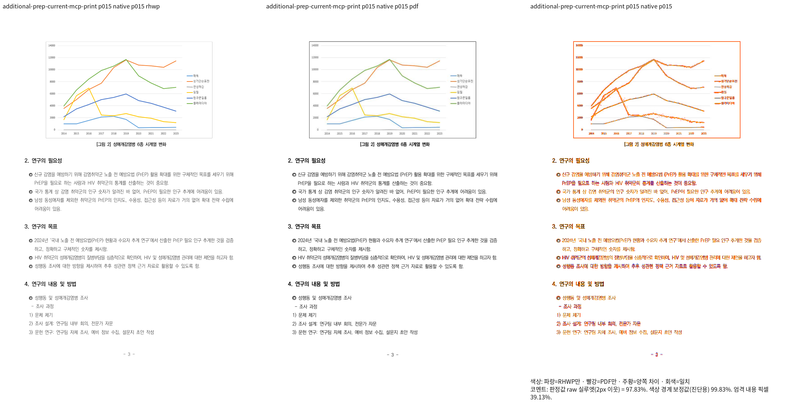
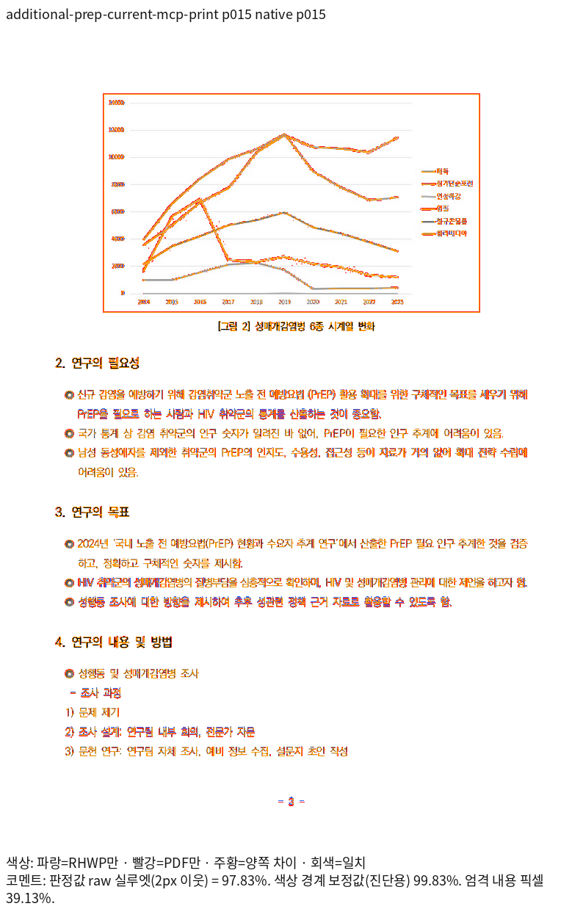
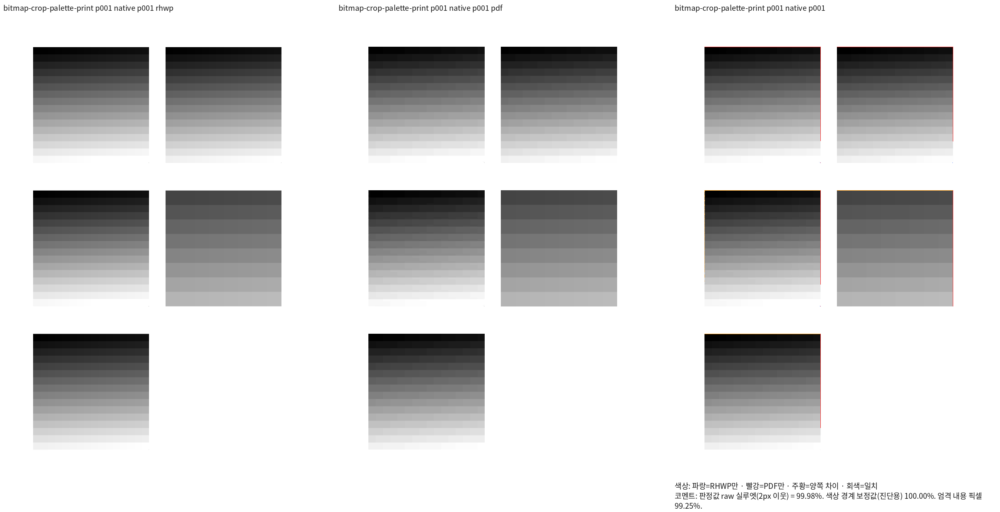
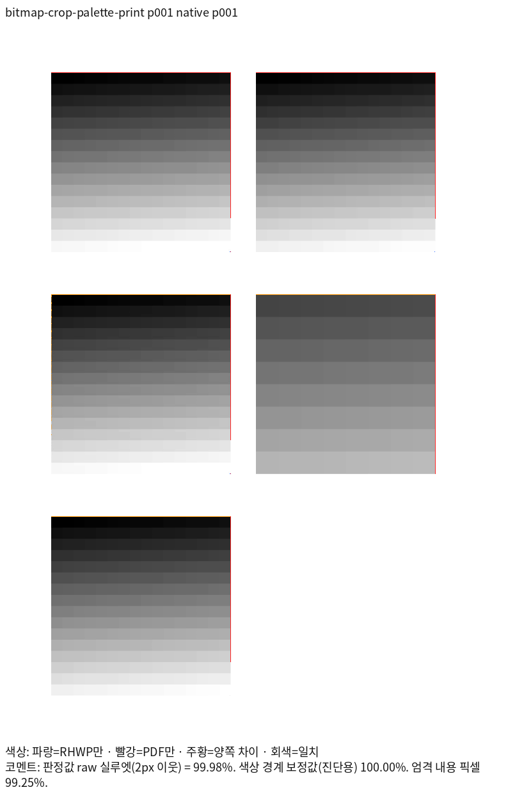
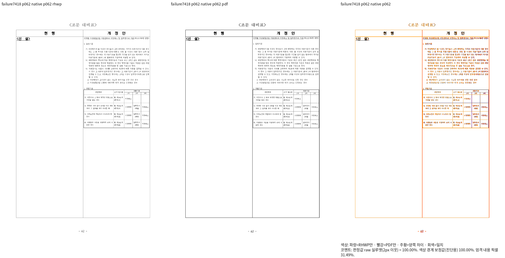
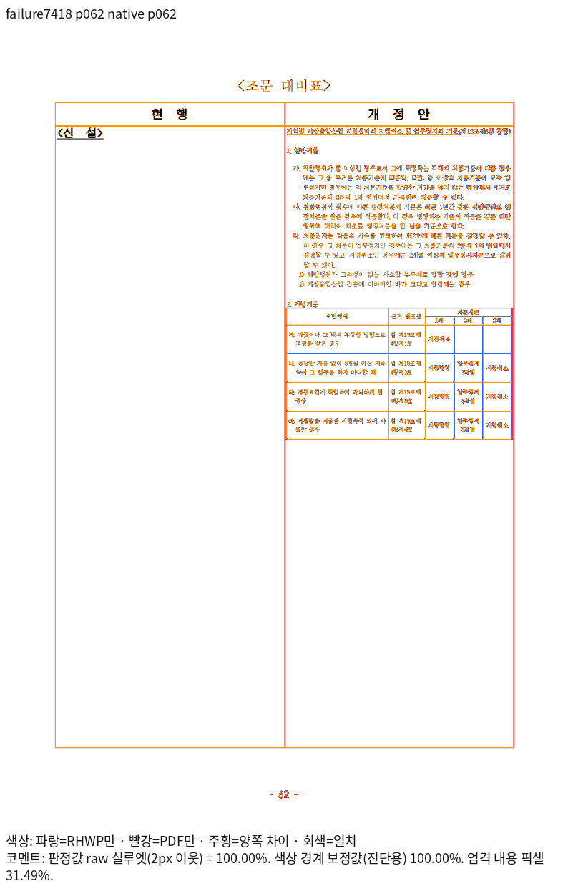
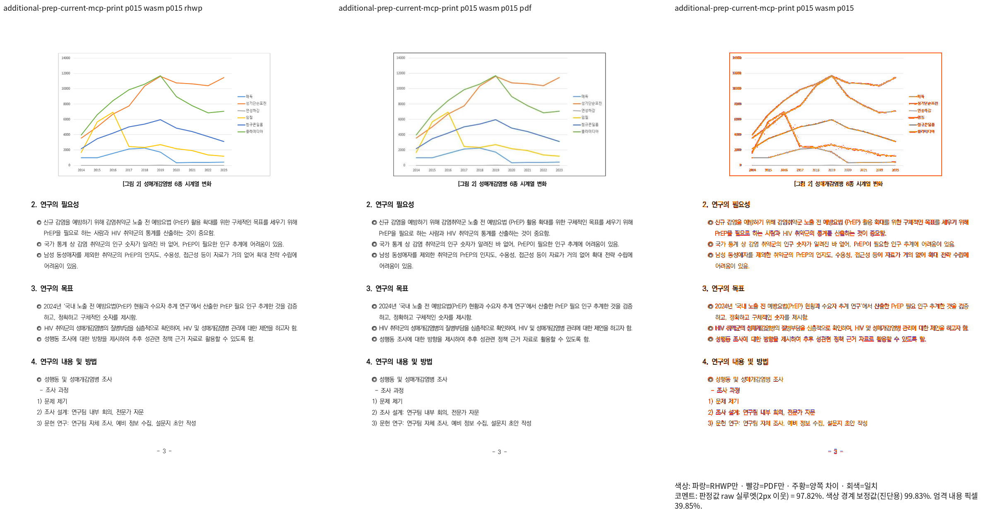
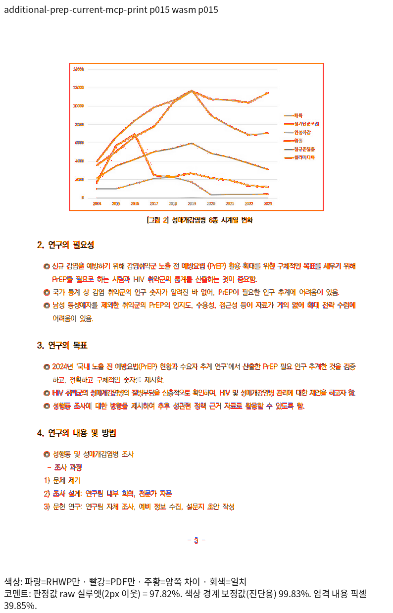
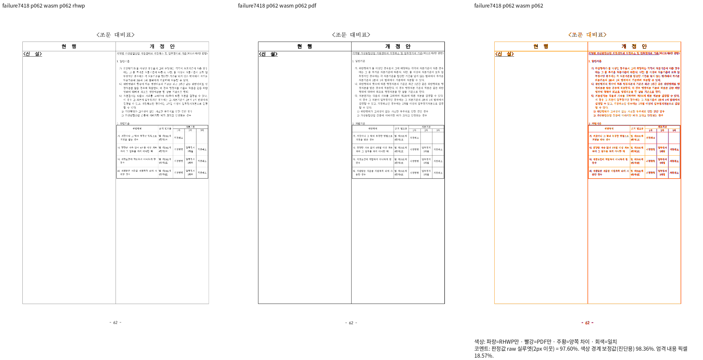
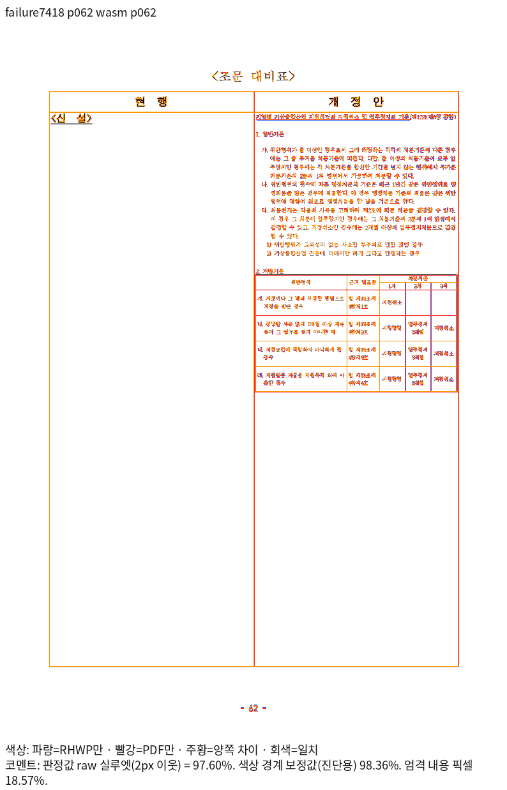
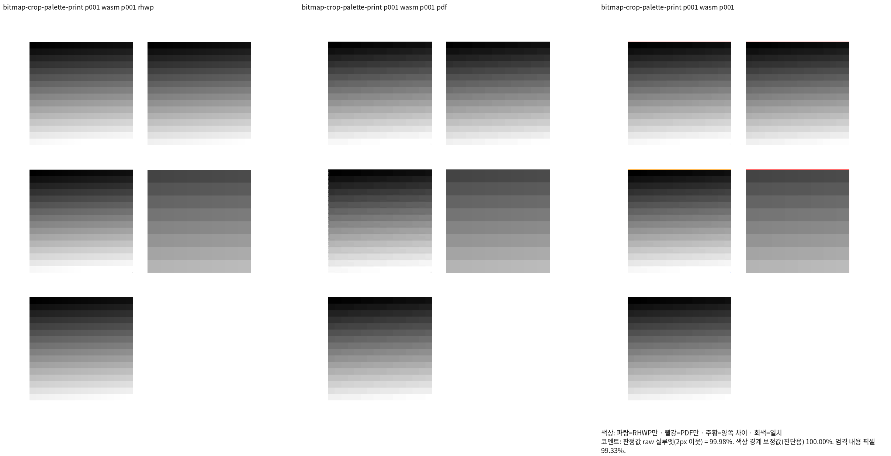
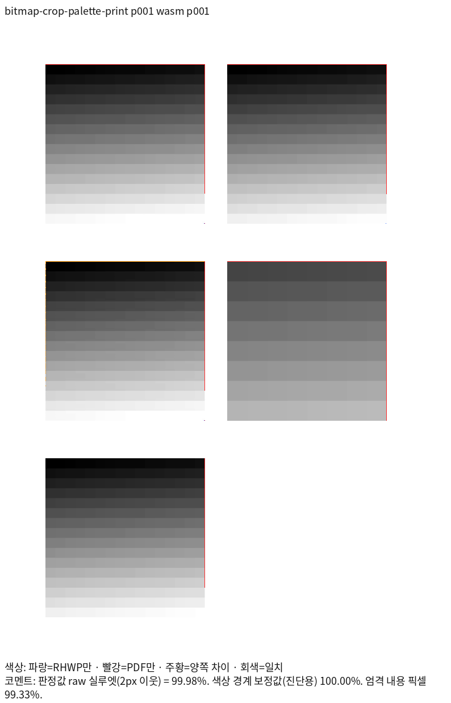
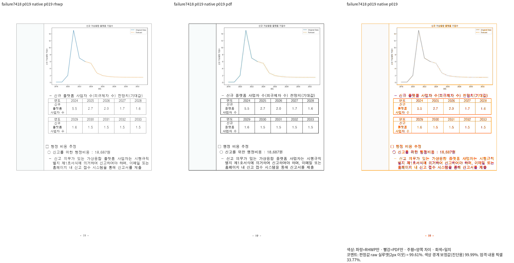
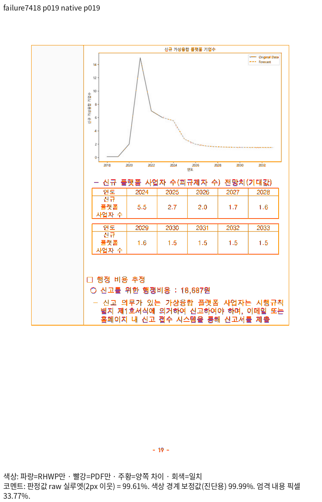
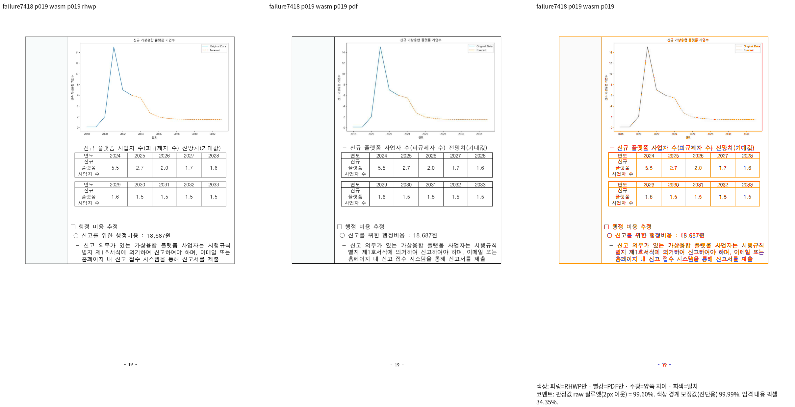
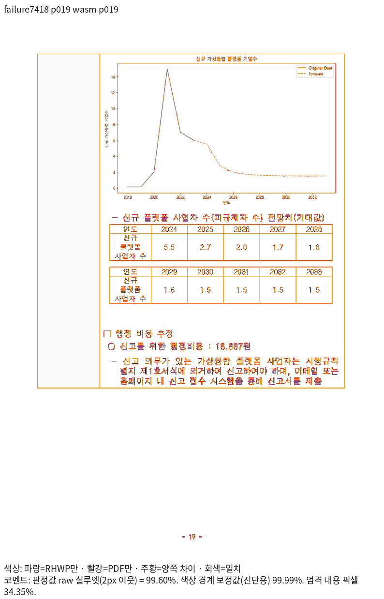
