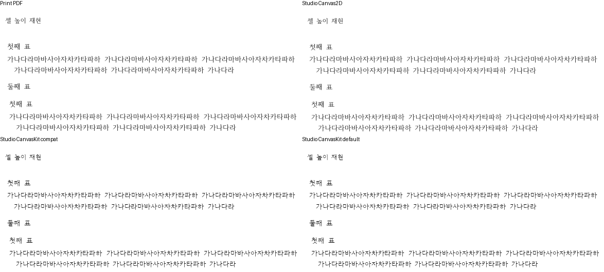

# PR #7433 메인터너 보정 시각 자산

- 검증 code: `59d87766f96a72b8502a49aff31c66dd16b9742c`.
- 기준 devel: `4662c069e557e928ed7968d061121fde90b1f027`.
- 전체 입력11문서15쪽 Native/fresh WASM의2px 관용 실루엣 최저100%, 독립 Print 쪽수 일치.
  엄격 픽셀100%라는 뜻은 아니다. 여백·분할·wrapper·뒤 본문을 포함해 전쪽 직접 대조했다.
- 원본·독립 Print의 출처/해시는 [Stage1](../../../working/task_m100_7419_stage1.md),
  추가 분할2개의 고정 바이트와 실패 보정은 [Stage3](../../../working/task_m100_7419_stage3.md)에 있다.
- 전체 원시 TSV·실행 로그·producer 해시는 ignored
  `output/pr-review/pr7433-current-20261016/regression-fix/`에 보존한다.
  `candidate-{native,wasm}-sweep/<입력>/silhouette.tsv`, `producer-provenance.json`,
  `final-direct-read.json`, `final-devel-comparison.json`이 최종 source의 증거다.
- 비교 가능한8문서는 devel 대비 하락0이다. 나머지3문서는 정상 쪽수 복구로 base TSV가 없어
  전쪽 일대일 gate는 **re_review_required**다. 최저100%로 이 보류 조건을 면제하지 않는다.
- Studio 추가 캡처는 실제 Canvas2D·CanvasKit compat/default software의 Print profile이다.
  초기 WASM 응답6개의 SHA가 위 fresh package와 일치한다. replay hard violation0,
  내용·줄 소속·겹침을 직접 확인했다. backend 간 report-only 엄격 픽셀 비교4건은
  불일치다(최대0.01088193). 이를 parity gate 통과로 표시하지 않는다. glyph 윤곽과 화면 안내선
  차이가 있으며, 아래 Studio 비교 PNG는 독립 PDF의 내용 영역을 같은 좌표로 잘라 판독한 것이다.
- [개별 검토](../../archives/pr_7433_review.md). GitHub PR 생성·승인·merge는 별도이며 아직 수행하지 않았다.

## 대표 PNG

## 파일 SHA-256

| 파일 | SHA-256 |
| --- | --- |
| [native-nested-source-review-001.png](native-nested-source-review-001.png) | `30c86453d624e82a96d522a45080e89ee5150a39ffdd8d8562da5575bc579f1e` |
| [native-partial-width-review-002.png](native-partial-width-review-002.png) | `d43a1948a3b7b9dbc39bd3e7e66e44cbdf22524bf3854d7444185b9fba5a9ce2` |
| [native-wrapper-review-002.png](native-wrapper-review-002.png) | `5eb1d2f6e6d2fd4aabc11b6d5433d93a1f0b4a6ccdfb00c0d96e90c5b9c28ac0` |
| [native-margins-review-001.png](native-margins-review-001.png) | `5bf59f5c579386396ef9a8bfddece2b854829d8b40e86e31f0cfd7e6624c6fda` |
| [native-nested-source-overlay-001.png](native-nested-source-overlay-001.png) | `be30045b3126e74fa0b5ce40a2633aecb6758db5f32b1664f176d87ae1f95ef9` |
| [native-partial-width-overlay-002.png](native-partial-width-overlay-002.png) | `618666d860f2da23df953277e2421c00f216507cde6f21f1b7bd9903e731710f` |
| [native-wrapper-overlay-002.png](native-wrapper-overlay-002.png) | `d11737d314d3c12e4c32809c303a5069a867c05ddd9252612f3d0f9af9677deb` |
| [native-margins-overlay-001.png](native-margins-overlay-001.png) | `6c4b91d43a174e6aa42dd5a79ff4b15389035a3be5a13cfb0ab0f8816dfb4353` |
| [native-partial-width-review-001.png](native-partial-width-review-001.png) | `2960b12c8f56a48a12c6366db7d83cf2924f4e8fcaa7fc5d0589b87c6528119c` |
| [wasm-nested-source-review-001.png](wasm-nested-source-review-001.png) | `d406d6f185ad055b96aa458979bbb9d698242bdaafc39c9d3ea73242c373a325` |
| [wasm-partial-width-review-002.png](wasm-partial-width-review-002.png) | `13a1aa5716befe67931a833d23b88ad07e1ae63bf0a6fab2f3a05211e6a1cc7d` |
| [wasm-wrapper-review-002.png](wasm-wrapper-review-002.png) | `ccdc8720feed14956a2670b0cd53a83ac2f05229ca7f4f918948beb1b48ece70` |
| [wasm-margins-review-001.png](wasm-margins-review-001.png) | `2d5fa2dc1880e3c88471a79cd06cda9352387822a9aa754759b2c24c51238240` |
| [wasm-nested-source-overlay-001.png](wasm-nested-source-overlay-001.png) | `76bb47ce4d813b1a529ea5dbdf10fed44d154a3f0295ef34dffefbfed8257cd0` |
| [wasm-partial-width-overlay-002.png](wasm-partial-width-overlay-002.png) | `b2462bc1113e9b0681a06c1bfa328aeec1cc21fb554c55bc066259257206e080` |
| [wasm-wrapper-overlay-002.png](wasm-wrapper-overlay-002.png) | `2292329b45c6502c414714db4eb3c2b5b3637213b98a5ac7d9e85ff78451cb23` |
| [wasm-margins-overlay-001.png](wasm-margins-overlay-001.png) | `a5f64f3e7a31dacba76197d3978193f0d5edb91fb6ea6023b96d01609974e166` |
| [wasm-partial-width-review-001.png](wasm-partial-width-review-001.png) | `37fadb760a9b03bf18b56bc72657cd6e6ab4f8dc4e8fdf5cb96aeb02036898ec` |
| [studio-source-direct.png](studio-source-direct.png) | `d16b74a25263e4a4c32f6bc5ec3294521da3947cccd84f591c726632bcc3d2a8` |
| [studio-nested-direct.png](studio-nested-direct.png) | `84fac574e671a28296584c77fc52ed632d38cf5d9045a006780e81d7873782b6` |
