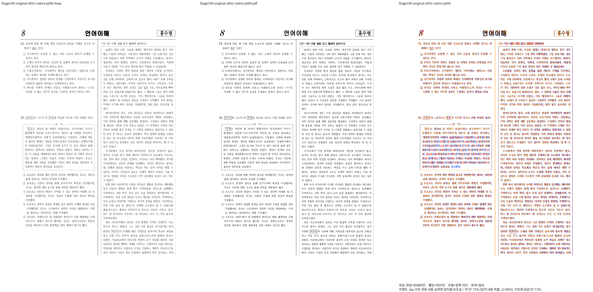
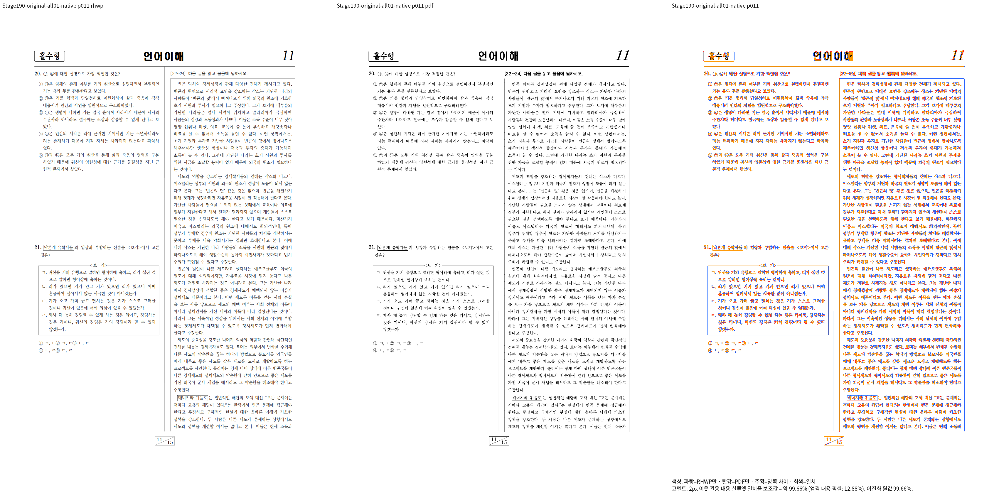

# #7642 Stage 190 — 인라인 표시 뒤의 실제 글줄 소유 조회

Issue: #7642

## 원인과 구현

Stage 189에서 언어 15쪽 중 13쪽의 Native gate가 통과하고 8·11쪽은 미달이다. 앞 문단은 TAC 도형을 소유하며 section controls가 같은 문단의 Shape 표시를 텍스트 뒤에 방출한다. 마지막 표시 항목을 별도 흐름으로 해석한 stored_tac_page 조회가 실제 글줄 소유와 확정 하단을 잃었다.

`paragraph content map → section의 같은 문단 TAC 표시 → state.previous_text_content_bottom의 Full/PartialParagraph 소유 조회 → 원본 마지막 줄/상대 간격 인증 → StoredTacPlan fit/origin/end → 배치/paint`를 연결한다. 같은 소유 문단의 실제 TAC 그림·도형·수식·양식 표시만 지나 앞 텍스트를 조회한다. 다른 문단 표시, 독립 float, 표, 표시만 있고 실제 텍스트가 없는 경우는 수용하지 않는다. 기존 full/partial의 끝 줄 키를 유지한다. 인라인 판정은 하단 생산과 조회가 같은 helper를 사용한다. 지워지는 표시나 px 위치 보정은 없다.

## 검증

이전 source의 Native·정상 대조군·10월 경계 검증이 종료되고 source 해시 불변을 확인한 뒤 수정한다. 언어 전쪽과 정상 대조군, 10월 경계를 새 Native에서 다시 확인하고 Native 전쪽 통과 뒤 fresh WASM 전쪽 TSV와 확대 판독을 이어간다. 새 정식 관계 회귀는 해당 원본의 모든 Native/fresh WASM 페이지 90% 이상 및 직접 판독 이후에만 추가한다. Cargo는 공용 `/home/tsjang/rhwp/target/pr-review`에서 순차 실행한다.

사전 fmt·fmt check·diff check 및 공용 target의 `cargo check --locked --lib --bin rhwp`는 exit 0, 25.54초다. 실제 Native/fresh WASM 결과는 아직 미검증이며 새 회귀 기대값을 추가하지 않았다.

## Native 재검증과 직접 판독

검증 source는 `9aa01e7cbc4d741d5cf3fb5950a0405e479d0f57`, Native 바이너리 SHA-256은 `358c710353d52bd381588494526685c445d7d886263e879a79f8659f51b8b2d6`이다. 입력은 `samples/21_언어_기출_편집가능본.hwp`, 독립 기준은 `pdf/issue7642-exam-print/exam-01-21_언어_기출_편집가능본-hwp-print-2020.pdf`이며, 입력·PDF 해시와 정확한 명령은 ignored `output/pr-review/issue7642/failed-inputs-20261008/stage15-current-validation/stage190-all01-whole-native/receipt.json`에 보존한다. Native는 `--compat 2022 --embed-fonts=full --dpi 96 --silhouette-only`로 전체 15쪽을 실행했다.

| 범위 | 실제 결과 | 판정 |
| --- | --- | --- |
| 언어 원본 전체 15쪽 | 최저 95.15308%, 미달 0쪽, 출력·기준 각 15쪽 | Native 충족 |
| 언어 8쪽 | 97.70647%; 앞 문항 → 보기 상자 → 선택지 순서와 상자 외곽 확인 | Native 배치 충족 |
| 언어 11쪽 | 99.65631%; 앞 문항 → 보기 상자 → 선택지 순서와 상자 외곽 확인 | Native 배치 충족 |
| 정상 대조군 `samples/issue6469/wmf_fill_shapes.hwpx` 전체 15쪽 | 최저 92.83096%, 미달 0쪽, 출력·기준 각 15쪽 | Native 충족 |
| fresh WASM | 같은 source의 wrapper 빌드 진행 중 | 미검증 |
| 새 정식 관계 회귀 | Native/fresh WASM 선행 조건 전체 충족 뒤 추가 예정 | 미검증 |

8·11쪽의 새 review와 overlay를 직접 열었다. 보기 상자가 앞 문항을 침범하던 차이는 사라졌고, 양쪽 단의 상자 외곽과 줄 배치가 독립 Print 출력에 대응한다. 제목·본문 글자 윤곽과 일부 진하기 차이는 남아 있으므로 Native 배치 개선을 글꼴 완전 일치로 보고하지 않는다. fresh WASM 전쪽 결과와 같은 영역의 판독은 별도로 이어간다.

같은 단의 문단·표 소유를 조회한 진단은 2·3·8·11쪽에서 표가 앞 문단 마지막 줄 뒤의 원본 상대 간격을 보존함을 확인했다. 이전 source에서 2·8·11쪽은 순서/겹침 관계가 실패했다. 이 진단 JSON은 정식 Rust 회귀의 수정 전 FAIL / 수정 후 PASS를 대신하지 않는다.

## upstream 동기화

2026-10-13에 `git fetch upstream devel` 후 기본 작업 브랜치와 이 보정 worktree에서 각각 `git rebase upstream/devel`을 실행했다. 기준은 `552f5228d2dbfd6046c838f14241704f1bcb8a05`이며 두 HEAD 모두 이미 포함하고 있어 리베이스는 up to date로 끝났다. 커밋 재작성이나 source 변경이 없어 실행 중 검증의 source SHA를 유지한다. 실제 확인 영수증은 ignored output의 `upstream-sync-rebase-20261013-stage190.json`에 보존한다.
