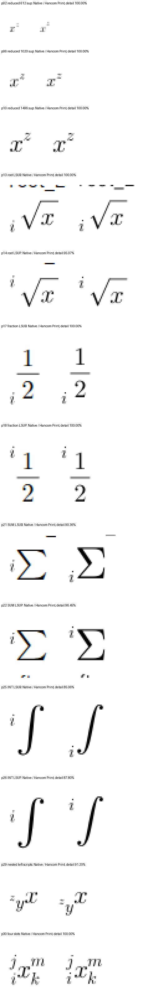

# #7642 Stage 192 — 근호 위첨자의 글줄 기준선 연결

Issue: #7642

## 독립 근거와 소비 경로

한컴 2020에서 재생성한 `pdf/issue7642-script-frame-diagnostic/observed-unit-frames-hancom-2020.hwp`와 같은 원본의 Print PDF 72쪽을 기준으로 사용한다. 800/900/1000/1100/1200/1600HU의 일반 글줄·근호·SUM·INT와 위/아래첨자를 함께 대조한 자료다. 기준 PDF는 Print 출력이며 후보에 맞추어 내용을 바꾸지 않는다.

실제 source `22966ae42be189ac900f7e665df0741c244015c5`의 공개 RenderTree/LayoutBox를 추적했다. 900HU 일반 글줄의 기준선은 10.32, 근호는 12.12이고 근호의 추가 상단 띠는 1.8이다. 근호 LSUP의 첨자 y는 1.236으로 본체 위쪽으로 충분히 올라가지 않는다. 이 값은 원인 진단이며 화면 기대 좌표로 고정하지 않는다.

`근호의 일반 글줄과 추가 띠 → logical_font_frame::superscript_shift → script_superscript_shift → layout_left_scripts/layout_superscript → 부모 기준선과 자식 y → 저장 수식 프레임의 최종 원점 → SVG/Canvas paint`를 연결한다. 현재 shift 조회는 본체가 font_line일 때만 일반 글줄 프로그램을 수용하여, 근호 본체는 공개 표시 글꼴의 MATH fallback으로 간다. 근호 아래첨자는 이미 같은 line_extension 조회를 사용하지만 위첨자는 추가 띠를 잃고 있다.

## 수정 후보와 반례

위첨자도 기존 line_extension의 일반 글줄/근호 계약을 소비한다. 독립 원본 글꼴의 위첨자 shift에 근호의 추가 상단 띠를 포함하고, 실제 본체 기준선에서 자식 원점을 계산한다. 크기·문서 ID·수식 문자열이나 절대 픽셀을 키로 하지 않는다. 분수의 별도 프레임 처리는 먼저 유지하며, 다줄·크기 변경·분수 혼재처럼 line_extension이 인증하지 못하는 본체는 기존 경로로 간다.

일반 x 위첨자, 근호 아래첨자, 6개 크기의 근호 위첨자, 분수·근 지수·중첩 본체를 함께 확인한다. SUM/INT/중첩 첨자의 알려진 차이는 이 근호 보정으로 해결됐다고 보고하지 않는다. 새 테스트 기대값은 전체 Native/fresh WASM 90% 이상 및 확대 판독 후에만 추가한다.

## 검증 계획

언어의 새 관계 case와 미주 TAC 후보를 포함한 이 worktree에서 수정한다. 진행 중인 다른 worktree의 불변 바이너리·WASM 검증을 보존한다. 사전 빌드 및 Native 후보 빌드는 수정 전 FAIL 입증의 Cargo/Rust 작업 종료 후 공용 `/home/tsjang/rhwp/target/pr-review`에서 순차 실행한다.

1. 전체 72쪽 Native TSV와 기존 script-frame 30쪽 TSV를 산출한다.
2. 근호 위첨자의 수정 전후/Print 확대, 정상 x·아래첨자 대조를 같은 배율로 확인한다.
3. fresh WASM에서 같은 범위를 재검증한다.
4. 구조·catalog의 남은 미달 페이지와 실제 수식 차이도 계속 보정한다. 전체 55개 원본·새 회귀·전체 Rust/lint·PR/CI/후속 처리는 별도 필수 범위로 남는다.

현재 후보는 미검증이다. 진단·명령·TSV·로그는 ignored output에 보존한다.

## 사전 빌드

공용 target의 `cargo check --locked --lib --bin rhwp`는 exit 0, 90.17초다. 실제 출력 및 시각 개선 완료는 아직 미검증이다.

## Native 전쪽 및 확대 판독 결과

실제 렌더 source `42918161fef78b73b6ee8c20063821a517f7b76f`의 Native 빌드는
exit 0이며 바이너리 SHA-256은 `47a98ae824a538cfab395c1e4a1c6c1bd6722ffe7dcaa545442aae1df496bc71`이다.
72쪽 실제/기준 쪽수 일치·누락 없음·최저 97.32197%, 30쪽도 쪽수 일치·누락 없음·최저
97.83051%다. 두 전쪽 비교의 exit code는 0이다. fresh WASM은 현재 빌드 중이므로
Native 결과를 양쪽 출력 경로 통과로 표시하지 않는다.

새 캡처를 직접 확대 판독했다. 루트 LSUP의 같은 영역 점수는 95.07389%이고 본체 위로
첨자가 올라간 것을 확인했다. 일반 위첨자 3개 크기와 근호 아래첨자·분수 위아래첨자는
각 영역 100%다. SUM LSUB/LSUP은 90.36145%/96.45390%이나 첨자 위치 차이가 남으며,
INT LSUB/LSUP은 85.06224%/87.79528%로 명확히 다르다. 중첩 왼쪽 첨자도 91.2%이나
위치 차이가 남는다. 전체 페이지 점수로 이 부분을 면제하거나 수식 전체 보정 완료로
판정하지 않는다. 적분의 그룹 본체와 첨자 소유, 중첩 본체의 글줄 프레임을 계속 추적한다.

같은 페이지·좌표계에서 Native Equation bbox와 독립 PDF의 수식 글꼴 span bbox의 합집합을
사용해 영역을 선택했다. 정렬 이동 없이 4배 확대했으며 진단용 crop 좌표를 회귀 검사에
고정하지 않는다. receipt는 ignored `stage192-script-frame-detail-review/receipt.json`,
전체 페이지 TSV와 명령·입력/PDF 해시는 `stage192-observed-units-whole-native/receipt.json`과
`stage192-script-frame-whole-native/receipt.json`에 보존한다. 새 관계형 회귀와 최종 전체
Rust/lint·55개 원본의 최종 Native/fresh WASM 검증은 아직 완료되지 않았다.
